# Architecture

An isolate is a statically linked Go execution with private package variables,
owned allocations and an attached group of native goroutines. The Temporal SDK
creates one deterministic isolate per cached workflow execution. A process can
run multiple isolates and host activities concurrently. Within a deterministic
isolate, only one application goroutine holds the execution token at a time.

## Component boundary

| Component | Responsibility |
| --- | --- |
| SDK `cmd/tgo` and `internal/toolchain` | Discover marked functions, generate typed invokers, classify dependencies, apply library overlays, produce the build manifest |
| Go command | Validate the generic manifest; compile selected state and compulsory checks; generate the process registration entry; hash effective inputs |
| Compiler | Emit GC-described package layouts and descriptors; redirect global addresses; preserve source provenance; check effects, access and reference publication |
| `internal/isolatestate` | Validate descriptors, order initialization, select private package tables, prepare audited frozen libraries |
| Runtime | Own allocation caches/spans, goroutine membership and dispatch, waits, faults, read-only execution, resources, time and randomness |
| `internal/isolatebridge` and public `isolate` | Opaque handles/programs, instance lifecycle and copied-byte transport |
| SDK `workflow` | Native workflow API, local serialization, inbound services, handlers, futures and binary command construction |
| SDK `temporalbridge` and `worker` | Host SDK bindings, task fencing, command execution, history replies, queries, cache cleanup and host observers |

```mermaid
flowchart LR
    Sources[Marked Go functions] --> Driver[SDK tgo driver]
    Driver --> Manifest[Generic build manifest]
    Manifest --> Compiler[Go command and compiler]
    Compiler --> Binary[One host executable with registered entries]
    Binary --> Host[Temporal host adapter]
    Host <-->|Copied request and reply bytes| Instance[Private package state and native goroutines]
    Instance --> Runtime[Owned spans, execution token and shared Go GC]
```

## State and ownership

Code, literal strings, type information in linker read-only sections and approved
immutable metadata can be shared. Every selected package has a typed layout
containing its mutable globals, allocated separately for each instance. The
current goroutine points to a table mapping immutable package keys to layouts.
Global access selects that layout or the original host variable. This is
package indirection, not relative pointers throughout the heap: values contain
ordinary absolute Go pointers and are traced by the existing collector.

Each instance has a numeric owner and an allocation cache. Every live application
heap span has one owner; spans are not mixed between instances. Small objects,
large objects, map storage, channels, closures and stacks participate in ownership
checks. Owner zero denotes host allocation, not immutability. Compiled reads,
writes and reference publication must be valid for their execution domain.

Read-only query and validator services use another allocation owner. They can
read workflow values, construct scratch values and serialize results, but cannot
mutate workflow state or publish scratch references back into it. Selected
library caches are rebuilt under scratch ownership. Explicitly frozen Unicode,
regexp syntax and strconv table backing data can be shared across instances;
each instance still has private bindings to those tables.

Protobuf is ordinary private state: descriptors, registries, `MessageInfo` and
coder caches initialize independently in each workflow and scratch service.
Generated descriptor literals stay in read-only binary storage. Host registries
and application objects are never shared through a typed host call.

## Execution and external decisions

A deterministic group has a token and FIFO queues, with high-priority, inbound
and read-only admission roles. A committed user wait, explicit `runtime.Gosched`
or exit passes the token. GC, asynchronous preemption and runtime housekeeping
do not choose another application goroutine. Host callbacks queue inputs; the
adapter delivers them at a suspension fence in history order.

Supported map iteration sorts keys instead of relying on Go hash order. Native
select and top-level random APIs use a replay-seeded stream. Workflow time is
supplied by history; durable timer waits are host commands. The runtime's own
scheduler/GC accounting continues to use real time. See [determinism](DETERMINISM.md).

`Call`, `ControlCall` and `ReadOnlyCall` copy both directions and block for a host
reply. `Write` copies observational output without acknowledgment. The SDK uses
protobuf envelopes, fixed-width identifiers and opaque serialized Temporal
payloads. There is no general host object, allocator or callback reentry API.

## Failure and lifetime

Ownership/effect/resource faults permanently revoke the group. Application
recovery and defers cannot resume it. Ordinary application panic/recover remains
Go behavior; an unrecovered child panic terminates its instance. Completion,
eviction and explicit kill wake supported waits and detach scheduler records.
`Done`, `Wait` and successful `Kill` establish the completed cleanup fence.
A kill deadline reports pending cleanup and cannot undo revocation.

Allocator caches and counters have independent lifetimes. Completed host handles
may retain copied diagnostics without retaining private state. The global GC
still scans suspended workflows; eviction releases references and ordinary GC
reclaims unreachable objects. No private collector or bulk heap-free operation
exists.

## POC limits

- Reviewed, statically linked code with one definition per Go import path.
- No dynamic loading, snapshots, relocation, stack serialization, general
  copy-on-write, frozen-heap GC or mixed-owner spans.
- No in-process hard kill of uninterrupted computation/native code, exact hardware
  CPU quota, or complete hostile-code containment proof.
- Supported effects and standard-library state are explicit implementation
  policies. An import alone is not a promise that every API in that package works.
- SDK external payload references, variadic handlers and automatic worker-stop
  cache teardown are outside the current integration contract.
- Private protobuf startup and span fragmentation make retained workflow memory
  substantial; use [the measurement fixture](MEMORY_DENSITY.md) for sizing.

Source pins and numeric contracts identify matching components. Equal contract
markers alone do not prove replay compatibility. The POC maintains one current
implementation; application history compatibility requires explicit replay checks.
